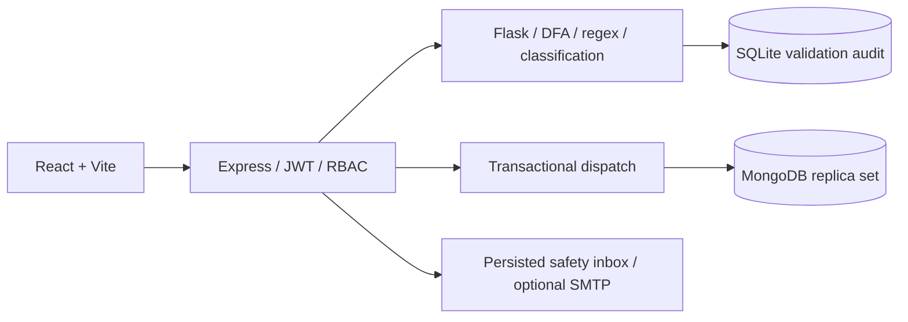

# Airport Ground Incident Logger

A working college engineering application integrating BCS503 automata, BCS502 routing, and full-stack development. All carrier/team assignments and provisioned identities are **fictional demonstration data**. Operational reports are created through the real API and persisted in MongoDB.

## What it does

- React/Vite workspace with staff, supervisor, safety officer, and administrator access.
- Flask explicitly simulates two DFAs and independently checks regular expressions, with interactive state diagrams and SQLite audit storage.
- Exactly five configurable incident categories, deterministic multi-match classification, and critical priority overrides.
- Database-backed airline routes, primary/backup assignments, capacity checks, correction/waiting queues, and persisted safety notifications.
- MongoDB transactions serialize dispatch and capacity changes across API processes. Unique indexes and scoped idempotency keys prevent duplicate submissions and assignments.
- Enforced Pending → Assigned → In Progress → Resolved workflow; resolution releases capacity and drains the queue.
- Search, date/category/status filters, incident history, attachments, six analytics charts, account provisioning, and audited administration.

## Architecture



The frontend talks only to Express. Python is the authoritative validator/classifier; service requests use a shared token, request IDs, and timeouts. See [architecture](docs/architecture.md), [automata](docs/dfa-design.md), [routing](docs/routing-table.md), [database](docs/database.md), and [API reference](docs/api-documentation.md).

## Local setup

Prerequisites: Node **24**, Python **3.12**, Docker with a running Linux daemon, and Chromium for browser tests. Node 22.12+ also meets the Vite engine requirement; this workspace was validated on Node 24.22.1. A MongoDB replica set is required for transactions; standalone MongoDB is insufficient.

Run from the repository root (or run `bash scripts/setup.sh` for the repeatable setup steps, then `node scripts/start.mjs`):

```bash
npm ci
python3 -m venv .venv
.venv/bin/pip install -r validation-service/requirements.txt
node scripts/init-env.mjs
bash scripts/mongo-local.sh
node --env-file=.env backend/src/seed.js
node scripts/start.mjs
```

Open the web server on port **5173** in a normal local environment. API: **3001**; internal validator: **5001**. The launcher waits for API dependency health and the web response. Logs are in `.data/`. Stop the launcher with Ctrl+C; stop only this project's database with `docker stop agil-mongo`. Existing data is retained in the `agil-mongo-data` Docker volume. Do not delete that volume unless intentionally resetting the local database.

`init-env.mjs` generates random local secrets in an ignored, mode-0600 `.env`; it never overwrites an existing file. Read `DEMO_PASSWORD` privately from that file. The seed command creates these accounts with that password:

| Email | Role | Scope |
|---|---|---|
| staff@agil.test | Ground Staff | Own submissions |
| supervisor@agil.test | Ground Handling Supervisor | H-AI assignments |
| safety@agil.test | Airport Safety Officer | Safety-Breach / critical reports, inbox |
| admin@agil.test | Administrator | System-wide |

To add the optional 100-report synthetic dataset, run `ALLOW_SYNTHETIC_DEMO=true node --env-file=.env backend/src/seed.js --incidents`. It covers all five categories and uses the real validation/dispatch/status workflow. See [synthetic data seed/reset/production safeguards](docs/synthetic-demonstration-data.md). This command is separate from base provisioning and is disabled by default.

The seed is repeatable and does **not** replace passwords, reset workloads, or insert incident reports. To use another team, provision a supervisor through Administration with its handler ID. Production accounts must be provisioned with controlled credentials; do not expose demo accounts publicly.

Separate `.env.example` files document service configuration. The root launcher loads the root `.env` and passes only the normal process environment to its children. Python uses a separate `PORT=5001` override. When starting services manually, load the appropriate environment first.

## Tests and build

Start MongoDB first. The Express suite starts its own real Flask process on port 5099 and uses a separate **agil_test** MongoDB database. It deliberately resets that test database; it refuses a database name without the `_test` suffix.

```bash
.venv/bin/pytest -q validation-service/tests
npm test
npm run build
# With the three development services running and demo accounts provisioned:
node scripts/test-browser.mjs
```

Playwright uses `/usr/bin/chromium`; override `CHROMIUM_PATH` on other machines. Alternatively install a supported Chromium and point that variable to its executable. The isolated browser helper submits clearly fictional reports to its dedicated test database and resolves its own report. They must never target production.

See [executed test cases](docs/test-cases.md) and [demo/viva guide](docs/presentation.md). Test result files and screenshots in `docs/` are evidence from this workspace, not a claim about future deployments.

## Deployment

Production build and local integration are verified. **No public deployment has been performed.** Deployment needs a hosting account, MongoDB Atlas replica set access, secure service credentials, durable validator/upload disks, and production staff provisioning. See [exact deployment steps](docs/deployment.md).

This is an engineering demonstration; real airport operation requires operational review, monitored backups, retention policies, abuse protection, attachment scanning, and organizational approval.
