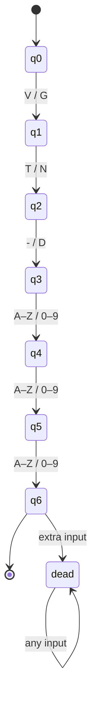

# DFA and regular expression design

Each automaton has states Q = {q0,q1,q2,q3,q4,q5,q6,dead}, start state q0, accepting set F = {q6}. Input is not trimmed or uppercased: `vt-abc` is correctly rejected. Dead transitions loop forever; any extra character after q6 enters dead.

| State | Aircraft accepted character | Incident accepted character | Next |
|---|---|---|---|
| q0 | V | G | q1 |
| q1 | T | N | q2 |
| q2 | - | D | q3 |
| q3 | ASCII A–Z | ASCII 0–9 | q4 |
| q4 | ASCII A–Z | ASCII 0–9 | q5 |
| q5 | ASCII A–Z | ASCII 0–9 | q6 |
| q6 | none | none | dead |
| dead | any input | any input | dead |

Every unexpected character at any state enters dead. Ending before q6 rejects. Implementation: `validation-service/dfa.py`, independent of the regex result.

The two labels refer to the two separate automata, not a union automaton. Unexpected transitions from q0–q5 also go to dead.

Equivalent regexes: `^VT-[A-Z]{3}$` and `^GND[0-9]{3}$`. Python `re.fullmatch` prevents the end-anchor newline exception. ASCII digit ranges intentionally reject non-ASCII numerals.

| Input | DFA | Regex | Agreement | Reason |
|---|---|---|---|---|
| VT-ABC | accept | accept | yes | q6 |
| VT-AB1 | reject | reject | yes | digit goes to dead |
| VT-AB | reject | reject | yes | stops at q5 |
| VT-ABCD | reject | reject | yes | extra input |
| vt-abc | reject | reject | yes | lowercase prefix |
| GND001 | accept | accept | yes | q6 |
| GND12 | reject | reject | yes | stops at q5 |
| GND1234 | reject | reject | yes | extra input |
| GND12A | reject | reject | yes | letter instead of digit |

The simulator displays both diagrams via selector, a per-character trace, a step slider, current-state highlighting, rejection reasons, and live comparison from Flask. The test suite also compares 4,000 seeded random inputs across the two automata.

Classification uses escaped configurable phrases and case-insensitive word boundaries. Priority is Safety-Breach, Damage, Equipment-Failure, FOD, Delay. The first matching category is selected; all matching categories and the ordered rule are retained. No match is rejected. Category labels are fixed; administrator rules must contain exactly those five nonempty lists.
